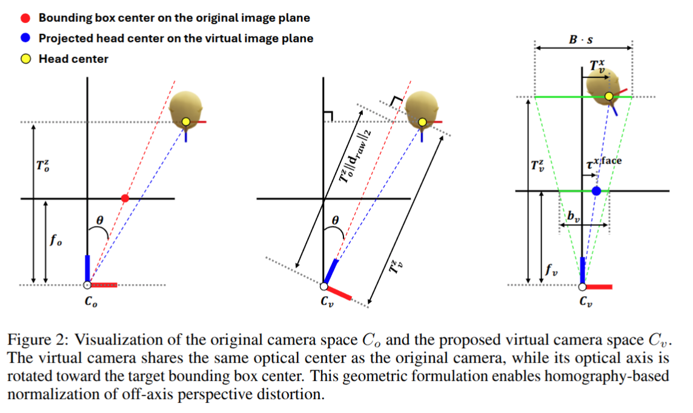
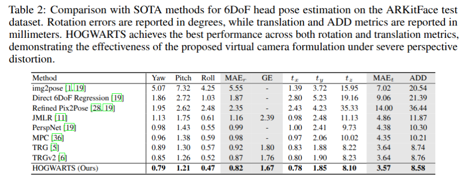
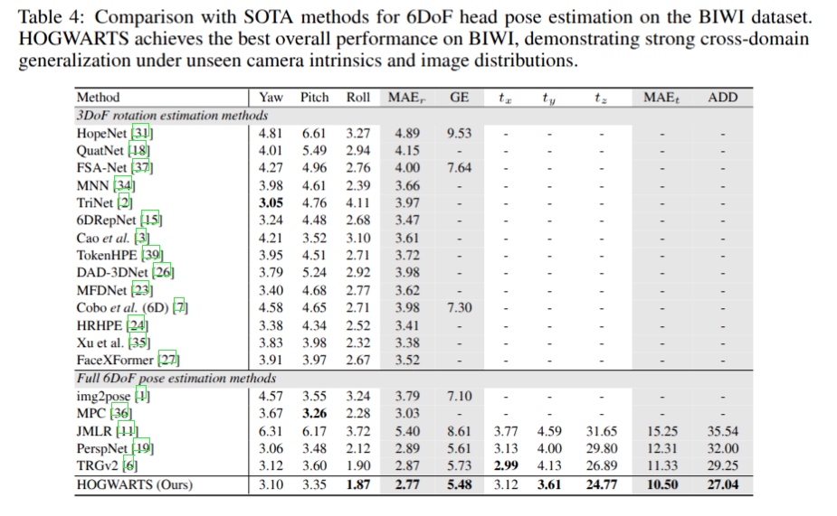

# [NeurIPS'26] HOGWARTS 🏰

- This is the official PyTorch implementation of [HOGWARTS: Mitigating Perspective Distortion for 6DoF Head Pose Estimation via Virtual Camera Space](https://neurips.cc/virtual/2026/loc/sydney/poster/150937) ([NeurIPS 2026](https://neurips.cc/Conferences/2026))

- We propose 🏰️ **HOGWARTS** 🏰, a geometry-driven framework that combines virtual-camera normalization via homography warping with a dynamic virtual bounding-box correction for metric 6DoF head pose estimation.

- 💪 HOGWARTS consistently outperforms prior methods on the ARKitFace and BIWI datasets under severe perspective distortion as well as in cross-domain settings.



## Overview

Estimating 6-degrees-of-freedom (6DoF) head pose from a single RGB image remains challenging under strong perspective distortion. We observe that the widely used design choice of rectangular face cropping introduces a geometric inconsistency. This leads not only to image--label mismatch under 2D rotation augmentation but also exacerbates perspective ambiguity, making it difficult to distinguish projection distortion from the actual appearance and pose of faces located near the image periphery. \rev{To address this issue, we propose HOGWARTS, a geometry-driven framework that combines established virtual-camera normalization via homography warping with a dynamic virtual bounding-box correction for metric 6DoF head pose estimation.} By explicitly defining a virtual camera that shares the optical center with the original camera and warping the input image into this space, our method compensates for off-axis distortion in a geometrically consistent manner. \rev{However, with the virtual focal length held fixed, retaining the original bounding-box size after image normalization leaves a position-dependent scale factor in the regression targets of the pinhole-based translation formulation. We analytically characterize this dependence and derive a dynamic virtual bounding-box correction that separates this geometric factor from the translation parameters learned by the network.} Consequently, HOGWARTS enables more geometrically consistent and robust 6DoF pose estimation across varying image locations. Experimental results on the ARKitFace and BIWI datasets demonstrate that HOGWARTS consistently outperforms prior methods under severe perspective distortion as well as in cross-domain settings.

## Installation

Please check [Installation.md](./docs/install.md) for more information.

## Demo

We provide guidelines to run end-to-end inference on test images.

Please check [Demo.md](./docs/demo.md) for more information.

## Download

We provide guidelines for the dataset, pretrained weights, and additional data.
Please check [Download.md](./docs/download.md) for more information.

## Experiments

We provide guidelines to train and evaluate our model.

Please check [Experiments.md](./docs/experiments.md) for more information.

## Results

HOGWARTS was trained exclusively on the ARKitFace training set and evaluated on the ARKitFace test set and the BIWI dataset. The evaluation results are presented below:




## License

Coming soon

## Citation

If you find our work useful for your research, please consider citing our paper:

````BibTeX
@inproceedings{chun2026hogwarts,
  title={{HOGWARTS}: Mitigating Perspective Distortion for {6DoF} Head Pose Estimation via Virtual Camera Space},
  author={Sungho Chun and Ju Yong Chang},
  booktitle={Advances in Neural Information Processing Systems},
  year={2026}
}
````
